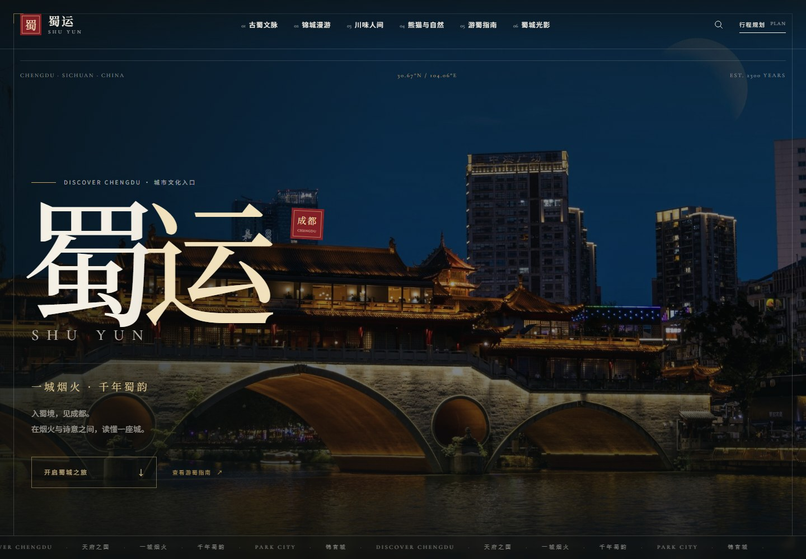
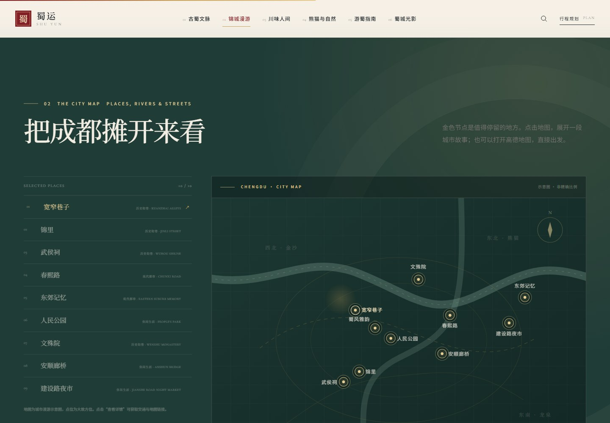
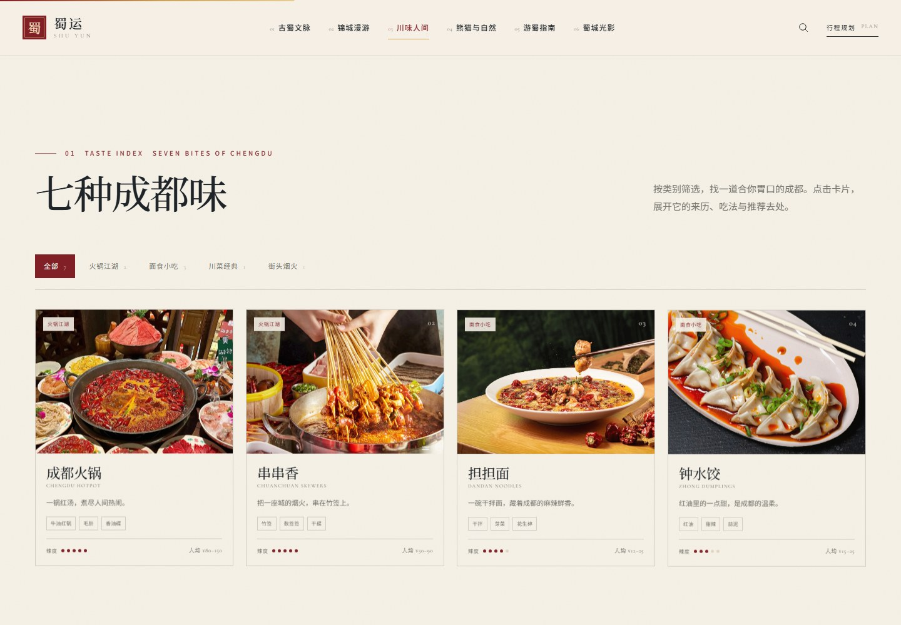
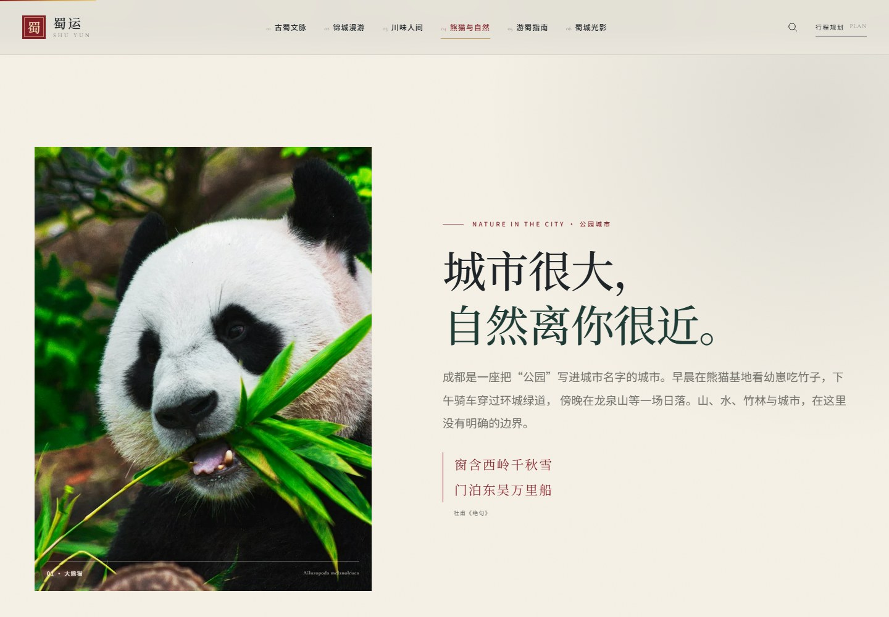
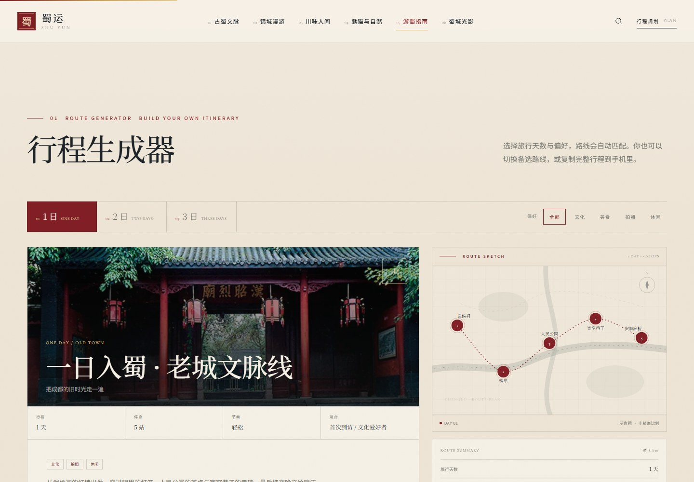
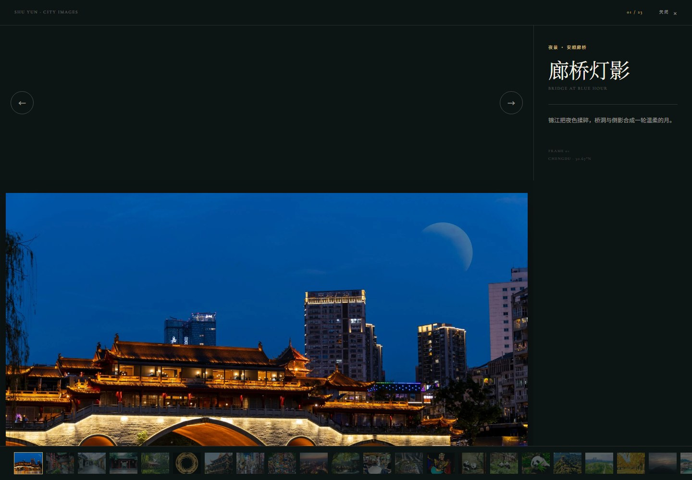
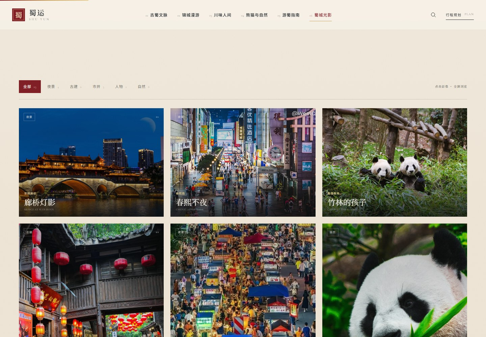
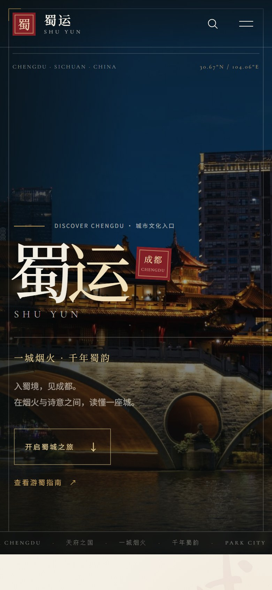
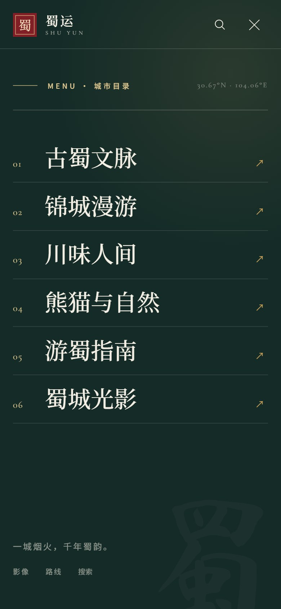

# 蜀运 SHU YUN · 成都城市文化旅游网站（GitHub Pages）

> 一城烟火，千年蜀韵。  
> 入蜀境，见成都。

**线上地址：** [https://summer7-f.github.io/web/](https://summer7-f.github.io/web/)  
**GitHub 仓库：** [https://github.com/Summer7-F/web](https://github.com/Summer7-F/web)

一个以成都为主题、具有现代国风美学的城市文化旅游网站。项目以「1 个首页 + 6 个独立分页面」组织内容，用影像、时间轴、手绘地图、味觉档案与行程生成器，把成都从“景点列表”还原成一本可以漫游的城市画卷。

## 界面预览

| 首页 | 古蜀文脉 |
| --- | --- |
|  |  |

| 城市地图 | 川味人间 |
| --- | --- |
|  |  |

| 熊猫与自然 | 行程生成器 |
| --- | --- |
|  |  |

| 影像灯箱 | 影像瀑布流 |
| --- | --- |
|  |  |

| 移动端首页 | 移动端目录 |
| --- | --- |
|  |  |

## 页面结构

| 页面 | 路由 | 核心内容 |
| --- | --- | --- |
| 首页 · 初见成都 | <code>/</code> | 全屏城市影像、六境入口、城市序章、推荐路线、精选影像 |
| 01 古蜀文脉 · 千年回响 | <code>/heritage</code> | 五段时间轴、金沙/武侯祠/草堂/文殊院、川剧与蜀绣 |
| 02 锦城漫游 · 城市之间 | <code>/explore</code> | 分类景点、景点弹窗、互动城市地图、三条散步路线 |
| 03 川味人间 · 百味成都 | <code>/food</code> | 美食分类、随机“今日吃什么”、七道川味、味觉坐标、夜市 |
| 04 熊猫与自然 · 生态成都 | <code>/nature</code> | 熊猫冷知识翻卡、六大自然目的地、天府绿道、四季风物 |
| 05 游蜀指南 · 行走成都 | <code>/travel</code> | 1/2/3 日路线生成、偏好筛选、路线地图、复制行程、行前清单 |
| 06 蜀城光影 · 镜头里的成都 | <code>/gallery</code> | 瀑布流影像、分类筛选、全屏灯箱、影像故事 |

## 已实现的交互

- 固定导航、滚动后转纸白、当前页高亮、移动端全屏目录
- GSAP + ScrollTrigger 的页面渐入、标题入场、滚动视差与卡片悬停
- 全站搜索（<code>Ctrl/Cmd + K</code> 或 <code>/</code> 唤起），跨页面/景点/美食/路线/影像检索
- 古蜀时间轴点击切换，配图片与故事过渡
- 景点分类筛选、景点详情弹窗、SVG 手绘成都地图、高德地图跳转
- 美食分类筛选、随机推荐、详情弹窗、辣度与味觉条
- 熊猫冷知识 3D 翻卡、季节切换、自然目的地详情
- 行程天数/偏好筛选、路线切换、一键复制行程、路线示意图
- 影像瀑布流、分类筛选、全屏灯箱、键盘左右切换、故事侧栏
- 响应式适配（桌面 / 平板 / 手机）、<code>prefers-reduced-motion</code> 支持
- 订阅表单、Toast 反馈、返回顶部

## 技术方案

- **Vue 3.5** + **Vite 6** + **Vue Router 4**
- **GSAP 3 + ScrollTrigger**：滚动与页面转场
- **自定义 CSS 设计系统**：<code>src/styles/main.css</code>
  - 未额外引入 Tailwind CSS。项目使用蜀红、鎏金、宣纸白、竹青、墨黑五色与一套语义化设计令牌，减少首屏样式负担，也便于后续品牌延展。
- 页面内容全部由本地数据驱动，方便更新：
  - <code>src/data/site.js</code>：景点、美食、时间轴、路线、影像、四季、贴士
  - <code>src/data/search.js</code>：全站搜索索引
- 图片统一为 WebP，存放在 <code>public/images/</code>，卡片图片按需懒加载。

## 本地运行

~~~bash
pnpm install
pnpm dev
~~~

默认开发地址：<code>http://127.0.0.1:5173/</code>

生产构建：

~~~bash
pnpm build
pnpm preview
~~~

> 当前工作区中 Vite 开发服务已启动在 <code>5173</code> 端口，可直接打开查看。

## 目录

~~~text
src/
  App.vue                    # 全局壳、搜索、Toast、页面转场
  main.js
  router/index.js
  styles/main.css            # 设计令牌与全局样式
  data/
    site.js                  # 内容数据（页面/景点/美食/路线/影像）
    search.js                # 搜索索引
  directives/
    reveal.js                # 滚动渐入
    parallax.js              # 滚动视差
  components/
    SiteHeader.vue
    SiteFooter.vue
    PageHero.vue
    SectionHead.vue
    SearchOverlay.vue
    CityMap.vue              # SVG 城市地图
    RouteMap.vue             # 路线示意图
    AttractionModal.vue
    FoodModal.vue
    GalleryLightbox.vue
  views/
    HomeView.vue
    HeritageView.vue
    ExploreView.vue
    FoodView.vue
    NatureView.vue
    TravelView.vue
    GalleryView.vue
public/
  images/                    # 已优化的 WebP 影像
  favicon.svg
  .nojekyll
.github/
  workflows/deploy.yml       # GitHub Pages 自动部署
pnpm-workspace.yaml          # pnpm 11 构建白名单（esbuild）
~~~

## 发布到 GitHub Pages

项目已改成 **GitHub Pages 静态部署** 版本：

- Vite 使用 <code>base: './'</code>，因此不依赖仓库名，放在 <code>summer7-f.github.io/web/</code> 或自定义域名下都能正确加载图片与资源。
- Vue Router 改为 **Hash 模式**。页面地址形如 <code>.../#/heritage</code>、<code>.../#/travel?route=one-classic</code>，刷新页面不会出现 404。
- 已提供 GitHub Actions：<code>.github/workflows/deploy.yml</code>。

### 首次发布

1. 在 GitHub 新建仓库，将当前目录推送到 <code>main</code> 分支。
2. 打开仓库 **Settings → Pages**。
3. 将 **Build and deployment → Source** 设为 **GitHub Actions**。
4. 推送代码后，Actions 会自动执行 <code>pnpm install</code>、<code>pnpm build</code> 并部署 <code>dist/</code>。
5. 部署完成后访问：<code>https://summer7-f.github.io/web/</code>。

> 不需要在 <code>vite.config.js</code> 里改仓库名；<code>base: './'</code> 已经适配项目子路径。

### 手动构建

~~~bash
pnpm install
pnpm build
~~~

将 <code>dist/</code> 发布到任意静态托管即可。Hash 路由不需要额外的 404 回退配置。

## 内容维护

- **新增景点**：在 <code>src/data/site.js</code> 的 <code>attractions</code> 中追加对象。城市景点设置 <code>group: 'city'</code>，会自动进入漫游页、地图与搜索索引。
- **新增美食**：在 <code>foods</code> 中追加对象，设置 <code>category</code> 与 <code>flavors</code>，会自动进入筛选、随机推荐、搜索与味觉卡片。
- **新增路线**：在 <code>travelRoutes</code> 中维护 <code>days</code>、<code>tags</code>、<code>stops</code>。每个 <code>stop</code> 通过 <code>spotId</code> 引用景点，做到“路线与景点信息分开维护”。
- **新增影像**：在 <code>galleryItems</code> 中维护，<code>aspect</code> 支持 <code>wide / tall / square</code>。
- **搜索**：<code>search.js</code> 会自动从上述数据生成索引；新增内容后无需手动维护另一份列表。

## 设计说明

- 主色：蜀红 <code>#821F26</code>、鎏金 <code>#D2AD6A</code>、宣纸白 <code>#F5F0E6</code>、竹青 <code>#203C37</code>、墨黑 <code>#1E2428</code>
- 标题：Noto Serif SC / 宋体回退；英文衬线：Cormorant Garamond；品牌标题可使用 Ma Shan Zheng
- 影像处理：低饱和、深色渐变、细颗粒与鎏金细线，保持“现代国风 × 高级旅游影像”的统一气质
- 桌面优先采用非对称编辑式排版，移动端转为单列叙事，保证阅读节奏

## 影像与资料说明

- 文化资料参考：文化和旅游部、杜甫草堂博物馆等公开资料。
- 演示图片来自公开网络（含 Unsplash 等来源），仅用于本项目视觉展示与文化氛围表达；正式商业上线前，请逐张确认授权，或替换为委托拍摄/购买授权的成都实景影像。
- 页面中的时间、票价、交通与开放信息为旅行灵感参考，出发前请以景区官方发布为准。

## GitHub Pages 说明

- 当前已启用 GitHub Actions 部署，Pages 的 <code>build_type</code> 为 <code>workflow</code>。
- 使用 Hash 路由后，所有页面都是同一份 <code>index.html</code>，不需要 <code>404.html</code> 或服务器 rewrite。
- 搜索、景点详情、路线、影像灯箱等深链接使用 query 参数，例如 <code>#/explore?spot=wuhou</code>、<code>#/gallery?photo=bridge</code>。
- 构建产物在 <code>dist/</code>，由 GitHub Actions 上传为 Pages artifact。
- 如果之后绑定自定义域名，仍可直接使用 Hash 页面地址。
